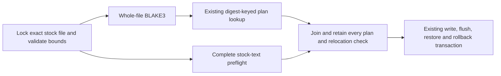

The next gains come from doing less discovery work and overlapping the two compulsory startup reads. New disposable experiments found **11–15% less cached patcher latency** from overlapping whole-file hashing with complete stock-code comparison, and **13–30% less first-discovery analysis time** from screening candidates before expensive function trimming. These are separate paths: a cached plan already skips discovery, so the percentages cannot be added.

Research date: November 11, 2026. Base source: `632af3a258b9fced2012c6dc719312853a3b0aa6`. Production C++, build settings, deployment DLLs, installed browsers and cache protocol were unchanged. Source identities, observations and validation are recorded in [PERFORMANCE-FRONTIER.json](PERFORMANCE-FRONTIER.json). Disposable sources, build commands and logs are under `_scratch/perf-frontier-2026-11-11/` and the discovery experiment directory named in the record.

[Continued experiments](PERFORMANCE-FOLLOWUP.md) identify repeated page-protection queries, test worker/window/threshold combinations and document further overlap variability.

## What is already solved

The current build already has `/O2`/LTCG, vetted BLAKE3 assembly/ISA dispatch, balanced adaptive hash workers, persistent DPAPI plan caching in the parent, bounded SIMD candidate/reference searches, shared optional reference traversal, one exact function-trim cache, relocation block filtering and deferred mapping cleanup. Adding these again offers no new gain. The earlier studies contain their measurements and rejected alternatives: [initial research](PERFORMANCE-RESEARCH.md), [deep dive](PERFORMANCE-DEEP-DIVE.md), [shared references](PERFORMANCE-NEXT.md), [threading](PERFORMANCE-THREADING.md).

Three independent states matter:

| State | Work it avoids | Work that remains |
| --- | --- | --- |
| Valid protected patch plan | Decoding, solving, optional recognizers and helper discovery | Whole-file identity, loaded-code validation and patch transaction |
| Stock file resident in physical RAM | Most backing-store reads | Fresh-view soft faults, hashing and comparison |
| Retained, fully touched mapping | Most mapping faults too | CPU/cache/memory-bandwidth work |

A fresh mapping is not a cold disk. Microsoft says `PrefetchVirtualMemory` caches physical pages without adding them to the process working set. A retained-map hash microbenchmark therefore hides costs present during actual startup. [Prefetch semantics](https://learn.microsoft.com/en-us/windows/win32/api/memoryapi/nf-memoryapi-prefetchvirtualmemory), [working sets](https://learn.microsoft.com/en-us/windows/win32/memory/working-set).

## Experiment 1: overlap stock preflight without a new cache scheme

The previous deep dive proposed finding a metadata-keyed candidate plan before hashing. A simpler ordinary-startup path needs no plan: compare **all loaded `.text` against stock `.text`, including checked relocations**, while the current `StockImage` constructor computes whole-file BLAKE3. Read the existing digest-keyed cache afterward and join the comparison before any writes.

If stock preflight finds any mismatch, use the unchanged plan-aware validation. This preserves already-patched images, mixed-state rejection and unexpected-modification rejection. A failed preliminary comparison must not automatically decline an otherwise valid existing plan.

| Fresh native image and file views; cached plan | Current patcher return | Overlap return | Reduction | Current / overlap through cleanup |
| --- | ---: | ---: | ---: | ---: |
| Chrome 153.0.8010.37 x64 | 306.520 ms | 260.219 ms | 15.11% | 374.036 / 323.034 ms |
| Chromium 157.0.8103.39 x64 | 278.856 ms | 243.641 ms | 12.63% | 344.009 / 307.586 ms |
| DCHECK Chrome 159.0.8148.1 x64 | 514.117 ms | 456.909 ms | 11.13% | 624.922 / 574.408 ms |

The same native DLL runs both modes. Each image has 16 retained observations per mode in alternating forward/reverse pair order, plus excluded discovery/warm-up observations. Each observation creates a new loaded-image mapping and a new stock file view; it executes the actual `Patch`, scanner identity, protected cache lookup, `ApplyPlan` and deferred cleanup code. Chrome itself is never initialized or executed. All 102 successful observations, including warm-ups, installed the exact expected bytes at every reported site. Additional checks retained `alreadyApplied` and rejected unexpected text changes near both ends without patching. Every stock file's SHA-256 remained unchanged.

These are exploratory medians under background load, with uncontrolled file-cache state. A separate discovery experiment briefly overlapped early Chrome 153 observations; no claim of isolated CPU scheduling is made for that population. The later two image populations ran after that experiment stopped. The initial prototype run is excluded: its adversarial fixture targeted raw-section tail padding outside the actual validated `min(raw, virtual)` text range. The corrected run uses the production range definition and retains every relocation structural check.

The overlap consumed more CPU through cleanup: medians rose about 5%, 6% and 11% respectively. It also made the comparator slower than sequential validation because both readers competed for faults and bandwidth. For Chrome 153, sequential application was about 187 ms; concurrent preflight took about 228 ms, followed by roughly 30 ms of remaining application checks and commit. The gain is real in these samples, but substantially below ideal overlap. This is **not** an actual-browser first-window speedup, a controlled cold-boot measurement or a release validation.

### The non-obvious correctness constraint

Simply skipping `sameText()` after whole-text equality is unsafe. With zero relocation delta, a relocation can straddle a future decision/gap boundary and still compare equal over the whole image; the original gap-aware validator rejects that layout. The amended prototype retains the existing relocation-header, width, order, cursor and boundary checks for **every gap**, and omits only byte comparisons already completed successfully. A preferred-base straddling-relocation regression is included in the native prototype suite.

A production implementation should keep the proof private and bind it to the exact live/disk pointers, sizes, PE text range and one startup operation. The research-only Boolean parameter is not a proposed public API. All callback returns must join before views or stack tasks expire. Submission failure retains sequential behavior. The startup no-concurrent-code-writer invariant still applies; a helper miss extends the comparison-to-commit interval, so redo full validation on misses if that longer invariant cannot be guaranteed. Keep the default complete `ApplyPlan` API for other callers.

The reused native regression suite passed **350 checks**, including the added zero-delta relocation case. This validates the research prototype's byte-proof path and fallback, not a deployment DLL's loader ABI or actual Chrome launch.

Code affected: `autoscan_runtime.cpp:183`, `autoscan_apply.cpp:42`, and private runtime declarations. `Inspect` already supplies bounds before the constructor; no arbitrary-hash `StockImage` constructor or new cache protocol is needed. Validate x86 separately: full preflight plus existing gap checks may walk its dense text relocations twice.

## Experiment 2: postpone function trimming until a candidate needs it

The core scanner calls `boundaries.find(cp)` before its cheap CFG prefilter. `find` decodes a function to remove padding correctly. The existing one-entry cache removes repeated trimming, but most candidates still pay the first trim even though very few reach a complete `Program` build.

Metrics on the three inputs recorded **6,192 / 6,427 / 11,262 prefilter calls, but only seven core Program builds each**. Avoiding rejected functions' initial trimming has a much larger scope than caching the few successful full decodes.

The disposable lazy-trim variant first screens an authoritative **untrimmed x64 runtime-function range**. Only a preliminary traversal without capacity exhaustion that proves the candidate lacks required evidence skips trimming. Successful or inconclusive preliminary searches retain the original trimming and complete prefilter. Traversal-capacity exhaustion is inconclusive, not proof of rejection; existing stop-on-unsupported-decode behavior remains. This distinction prevents a naive move from suppressing candidates because additional padding exhausted a bound.

| Warm analysis only; hashing excluded | Current | Lazy trim | Reduction |
| --- | ---: | ---: | ---: |
| Chrome 153.0.8010.37 x64 | 460.596 ms | 379.696 ms | 17.56% |
| Chromium 157.0.8103.39 x64 | 471.846 ms | 409.247 ms | 13.27% |
| DCHECK Chrome 159.0.8148.1 x64 | 788.095 ms | 549.472 ms | 30.28% |

The isolated pass used `current, lazy, lazy, current` process order, five analyses per retained mapping and exclusion of the first observation in each process, leaving eight observations per variant/image. All 60 complete reports matched frozen reports after removing diagnostic hash fields. Both lazy trim and the initial register-query variant also matched **105 reports each across all 21 reviewed x64 files**. The lazy-specific self-check passed **225 padding, capacity-overflow, immediate, branch and unsupported-decode checks**. Earlier timings that overlapped another experiment were discarded. This does not establish native x86/ARM64 speed or cached-startup gains.

Code affected: `autoscan.cpp` prefilter/candidate loop and `boundaries.hpp` authoritative-range lookup. Preserve x86's heuristic boundary recovery; do not apply an authoritative-table shortcut there without separate evidence. Keep all ambiguity, unresolved-candidate and complete-report behavior.

An additional register-query variant skipped queries for registers the **current LiftX86 decoder** cannot produce, while preserving slot initialization. Its initial prefix-only experiment changed analysis 443.487→432.394 ms, 448.812→440.617 ms and 704.583→707.966 ms. The caller review also found the same query loop in `verify`, so a complete follow-up put the guard in shared `Program::constantBefore`: 514.231→668.632 ms, 450.645→477.443 ms and 1136.643→982.795 ms. Unrelated stages drifted strongly in that pass; neither experiment establishes a consistent useful gain. Each passed 60 benchmark-report comparisons, and the prefix-only variant additionally passed the 105-report matrix. Both remain unselected. [Modern x64 APX includes R16–R31](https://learn.microsoft.com/en-us/cpp/build/x64-software-conventions?view=msvc-170#x64-register-usage); any cap must follow decoder support rather than permanently assume the architecture has only 16 registers.

## Highest-value next experiments

| Priority | Experiment | Why / acceptance condition |
| --- | --- | --- |
| 1 | Actual Chrome launch A/B of stock-preflight overlap | Measure first usable window/extension request, total CPU, peak memory and cleanup contention; native probe latency alone cannot choose deployment behavior. |
| 2 | Finish lazy-trim integration review and held-out image/architecture checks | The new analysis win avoids real work. Verify bounded/inconclusive traversal and complete matrix parity before a production change. |
| 3 | Attribute residual apply time, then reuse safe preflight region evidence | The prototype still repeats allocation/readability queries after preflight. Time region/readability sweeps, relocation gaps, page queries, RW transition, flush and RX restoration separately. Do not assume the remaining 30–74 ms belongs to relocation scanning. |
| 4 | Test hash worker budget with one comparator reserved | Current hashing can use all eligible CPUs; another comparator oversubscribes that count. Compare adaptive, N−1 and a few coarse budgets on real launches rather than maximizing worker count. |
| 5 | Dynamic TLS followed by disabled DLL thread notifications | Potential aggregate child/thread-startup saving. Needs a measured full-browser win to offset TLS API overhead in hashing. |
| 6 | Release-DLL SPGO/PGO | Useful if profiles show CPU work; train cached and missed starts and held-out normal/diagnostic layouts. It will not optimize upstream assembly kernels or remove compulsory IO. |
| 7 | Rolling prefetch or streamed hash/compare | Use only after hard/soft-fault traces identify the remaining cost; distinguish it from the already slower whole-view prefetch policy. |
| 8 | Revisit bounded register queries only if profiling justifies them | The current-decoder experiment passed report parity but showed no consistent win. APX decoder support must expand the query range in the future. |

## Less obvious algorithm and binary-layout opportunities

| Trick | Assessment and boundary |
| --- | --- |
| Build reverse predecessor edges once | Current provenance/constant queries repeatedly scan all decoded nodes. Metrics recorded roughly 1.55M/1.70M/14.93M predecessor checks on the three images. Measure the small shared query guard first; a bounded reverse-edge index is justified only if the remaining profile is hot. Preserve all-path agreement and edge ordering. |
| Avoid duplicated constant initialization | `verify` initializes registers before `prefix` can initialize them again. For suitable non-memory comparisons, remove the redundant first fill while preserving original root-PC semantics and the memory-compare early return. Unmeasured. |
| Cache exact call summaries | A small immutable-image/callee/register/depth cache may avoid repeated callEffect/constantBefore walks. Count repeated keys before adding storage; preserve unknown and recursion-limit results. |
| Memoize constant/provenance queries | Key by immutable program generation, PC, register and parameters, including negative/inconclusive results. The state/limit overhead can erase savings; no general cache framework is warranted yet. |
| Reuse optional `Program` decodes | Current-image counts showed only 4–7 builds per stage and little same-range reuse. Low priority despite sounding attractive. Preserve complete/noReturns semantics. |
| Skip only unnecessary occupancy clearing | A small function should not necessarily zero all 64 KiB occupancy storage. Measure first; generation marks add wraparound and stale-state complexity. Keep byte ownership checks that prevent decoding branches into immediates. |
| Drain all reference SIMD mask bits | Current reference search restarts overlapping vectors after the first hit. Previous research already measured only about 1–2% overall standalone gain. Preserve ordered candidates, tails and per-target overflow. |
| Collect both anchor names in one actual `.rdata` pass | Existing RefBatch shares `.text` reference traversal, but its constructor still traverses `.rdata` separately for each name. Small bounded cleanup; no multi-pattern library needed. |
| SIMD-filter x86 absolute reference windows | The x86 reference scan examines unaligned 4-byte windows. A safe byte/pair prefilter may save loads, but needs actual x86 distributions and full decode/parity. |
| NEON filters for ARM64 / wider x64 filters | Fixed-width ARM64 instructions suit masks; wider x64 filters require correct CPU/OS dispatch. Current hardware did not establish these wins. Wider is not automatically faster when matches are dense. |
| ARM64 raw CMP and BL checks before Lift | The outer core loop currently fully lifts every instruction word; a checked raw CMP-immediate mask can reject most. Download-call discovery can check the signed BL target before lifting. Retain all current decoder encodings and full verification of survivors; native data required. |
| Decode once, share query indexes | More meaningful than adding a large disassembler dependency. Preserve unsupported-instruction declines and fixed bounds. |
| Parallel core/optional analysis | Helps misses only, uses separate mutable Program/solver/trim state, and must merge every ambiguous/unresolved outcome deterministically. Full report parity, extra stack and bandwidth count. |
| Dense x86 relocation normalization | Copy a bounded page/chunk, apply checked relocations locally, compare one large run. Could avoid millions of tiny comparisons, but adds copy traffic and cross-page/site logic. Preserve wraparound and original acceptance/fallback behavior. |
| One relocation/site merge | Avoid revisiting headers for every gap. Real global sorting must be validated; unsupported ordering should retain the old path. x64 block filtering already removes most entry work. |
| Coalesce changed protection pages | Only pages with compatible protection and rollback ownership. Few sites limit payoff; W^X and restoration remain mandatory. |
| Narrow instruction-cache flushes | API accepts ranges; batch changed pages without omitting flush on write or rollback. Measure native x64 as well as ARM64; no architecture-wide assumed saving. |
| Deduplicate repeated qualifying loader calls | `alreadyApplied` still pays full identity and code validation. First count actual repeated `Patch` calls. Successful-startup memoization needs module lifetime, address reuse and concurrency handling; an eternal HMODULE Boolean is unsafe. |
| Deduplicate solver states / discard dead values | Only equivalent PC, register, flag and constraint state can merge safely. PC-only deduplication is unsound. This is much more complex than the measured filter/trim changes; profile first. |

Do not stop a prefilter as soon as enough constants appear: the original traversal might later exceed its bound and decline, so early success changes acceptance. A whole-function byte summary can be a necessary rejection hint, but survivors still need the original CFG check. Old gate RVAs may prioritize work; they cannot replace scanning the rest of an updated image for additional or ambiguous sites.

## OS, IO, compiler and scheduling catalogue

| Trick | Assessment and first useful test |
| --- | --- |
| Replace static hash TLS with dynamic TLS | `thread_local Budget` keeps DLL thread notifications enabled in children that never hash. One `TlsAlloc` slot can point at caller-owned Budget storage until joins finish, avoiding per-thread heap. After confirming the final DLL has no static TLS, `/MD` permits evaluating `DisableThreadLibraryCalls`. Test nested/concurrent hashes, failure fallback, reused pool threads and unload. |
| Use `TlsGetValue2` opportunistically | Avoids LastError side effects, but requires Windows 11 24H2. Ordinary TLS plus optional runtime resolution retains older support; do not add a mandatory new import for a guessed gain. |
| Delay-load bcrypt | Crypt32 is already delayed. Children skip scanner work, but Chrome may already load bcrypt independently. Inspect ETW/imports first; do not delay APIs used in DllMain. |
| Lazy resolution of version exports | Current eager DllMain forwarding is small and proven. Lazy resolution adds ABI/concurrency/loader risk; require a visible sampled cost first. |
| Real release-DLL SPGO and function layout | SPGO can profile release binaries; cached/miss profile weights matter. `/Gy` already exists. `/ORDER` has static-function limits. The DLL is only about 219 KB, so instruction paging has a bounded independent opportunity. |
| Rolling prefetch of coarse future chunks | Different from the prior slower whole-file hint. Include hint time, hard faults and memory pressure; prefetch is a performance hint, never identity. |
| Prefetch live text while stock hashing runs | Can overlap IO but adds traffic and does not populate all process PTEs. Benchmark the complete joined path. |
| Buffered overlapped ReadFile with two bounded buffers | Explore coarse 1/4/16 MiB reads and small queue depths. Feed the same exact buffer to hash and full live comparison, preserving BLAKE3 streaming order. Extra copy/partial-read/cancellation costs count. |
| Fuse comparison at coarse hash subtrees | Stock bytes may still be cache-resident after hashing. Compare each byte once; nested recursive forks must not duplicate comparison. Keep upstream compression, tree counters, relocation normalization and whole digest identical. |
| Windows IO rings | Async read requires Windows 11 and operation-support checks. Ordinary overlapped IO is the first baseline; ring setup/registration is unlikely to pay unless submission overhead is measured. |
| Smaller mapped windows | Can reduce peak transient memory and x86 address-space pressure; adds mapping/unmapping and conflicts with random-access discovery. Whole-file digest still required. |
| Explicit prefault/touch workers | Fresh warm-cache views can still fault heavily. Touch-only work is additional work; test whether it improves the joined operation under working-set locks. |
| Memory-pressure-aware concurrency | CPU availability is a capacity bound. Extra workers can amplify page faults and evictions; only introduce a heuristic after measuring a crossover. |
| Low memory priority for disposable stock bytes | Hashing is immediately followed by stock-text reuse. Early eviction may make startup slower; process-wide policy also affects Chrome. No default recommendation. |
| Private pool or reusable work objects | Measure create/queue/ready/join time first. Default-pool capacity is not desired CPU parallelism; recursive waits need deadlock-safe fallback and bounded storage. |
| Thread-local startup QoS | Could affect hybrid-core placement/frequency before a foreground window exists. Measure default policy first and restore state on reused workers. Avoid global priority/power changes. |
| SMT/E-core/NUMA placement | Test end-to-end, not only hashing. The scheduler owns placement today. A NUMA preferred mapping does not relocate already cached physical file pages; copying needs amortization. |
| AVX-512 versus AVX2 across the next browser phase | Dispatch already exists. Frequency/power effects are hardware-dependent; compare usable-window time and energy, not historical downclock folklore. |
| Large pages / VirtualLock | Normal file-backed images are not drop-in large-page allocations. Privilege, commit, copying and eviction costs count. No demonstrated gain here. |
| Offer/DiscardVirtualMemory as cleanup | Not substitutes for unmapping the current read-only view. Discard requires writable pages and undefined contents; offer requires later reclaim. Ownership/module lifetime still must be handled. |
| Delay/deprioritize deferred unmap | A faster Patch return may still contend with Chrome. Queue priority is not OS scheduling priority. Measure first-window latency and eventual cleanup, without retaining a large mapping indefinitely. |

Sources: [DLL thread notifications](https://learn.microsoft.com/en-us/windows/win32/api/libloaderapi/nf-libloaderapi-disablethreadlibrarycalls), [dynamic TLS](https://learn.microsoft.com/en-us/windows/win32/dlls/using-thread-local-storage-in-a-dynamic-link-library), [TlsGetValue2](https://learn.microsoft.com/en-us/windows/win32/api/processthreadsapi/nf-processthreadsapi-tlsgetvalue2), [SPGO](https://learn.microsoft.com/en-us/cpp/build/sample-profile-guided-optimization?view=msvc-170), [function ordering](https://learn.microsoft.com/en-us/cpp/build/reference/order-put-functions-in-order?view=msvc-170), [QoS](https://learn.microsoft.com/en-us/windows/win32/procthread/quality-of-service), [ReadFile](https://learn.microsoft.com/en-us/windows/win32/api/fileapi/nf-fileapi-readfile), [IO ring read](https://learn.microsoft.com/en-us/windows/win32/api/ioringapi/nf-ioringapi-buildioringreadfile), [NUMA](https://learn.microsoft.com/en-us/windows/win32/procthread/numa-support), [mapping coherence](https://learn.microsoft.com/en-us/windows/win32/api/memoryapi/nf-memoryapi-mapviewoffile).

Microsoft does not guarantee coherence between a mapped file view and ReadFile/WriteFile access. Keep the exact input immutable throughout; do not authorize identity from independently changing byte sources. A fused IO experiment should consume each exact read buffer for both hashing and comparison, with complete error handling and a mapping fallback.

## Bigger architectures: fastest startup at a different cost

| Architecture | Potential | Why it is a separate design |
| --- | --- | --- |
| Prepare plans at installation/update time | Hide first discovery from launch | Correct final scanner identity, exact immutable Chrome file and user DPAPI scope; launch still hashes/validates. |
| Protected deterministic negative cache | Avoid repeated hopeless scans | Full browser/scanner identity; never persist IO failure, timeout or resource shortage as deterministic unsupported code. |
| Single-flight helpers during simultaneous misses | Avoid duplicate discovery | Bound waits, recheck cache, recover abandoned owners and retain deadlines. |
| Reply before cache durability/helper exit | Overlap persistence with parent validation | Current parent requires successful helper exit, so moving WriteCache alone hides nothing. Redesign response completion/lifetime before changing this contract. |
| Shared digest from continuously locked file owner | Remove repeated per-process hashing while immutability remains proved | A resident process/service, same-file object binding, IPC authentication, restart/update/replacement rules and writer conflicts. Per-process loaded-code comparison remains. |
| Authenticated precomputed chunk tree | Reuse stock subtree results where a sound immutability protocol proves unchanged content | Per-chunk bookkeeping and invalidation, not a timestamp shortcut. Hashing changed or unverifiable chunks still required. |
| Signed distributed precomputed plans | Remove local discovery for known official artifacts | Reintroduces distribution/maintenance/signing infrastructure; retain digest and local loaded-code validation plus automatic fallback. |
| OS/driver-enforced immutable content or executable-page evidence | Potentially avoid user-mode reads under a stronger trust contract | Installation/privilege/compatibility/update costs are far beyond a 219 KB drop-in DLL. No measured deployment benefit here. |
| Relax identity to text/version/signature bytes | Reduce mandatory input | Changes the existing whole-file/code-validation contract. These experiments did not do this. |

Metadata-only identity, PE timestamps/file IDs/size/version, remembered USNs, MEM_IMAGE status and QueryWorkingSetEx Shared bits do not prove the required content equality. Some read/RH oplock breaks allow the writer to proceed without acknowledgment; an event listener alone is not a race-safe cache. [VirtualQuery](https://learn.microsoft.com/en-us/windows/win32/api/memoryapi/nf-memoryapi-virtualquery), [working-set query](https://learn.microsoft.com/en-us/windows/win32/api/psapi/nf-psapi-queryworkingsetex), [oplock breaks](https://learn.microsoft.com/en-us/windows-hardware/drivers/ifs/breaking-oplocks).

Language rewrites, custom crypto assembly, GPU transfer/runtime startup, a new multi-pattern library, whole-view warm-cache prefetch, custom SSE equality, arbitrary CPU ceilings and global antivirus/power changes do not have evidence sufficient to displace the current native implementation. Several were already measured and rejected in the preceding studies.

## What would establish the fastest practical implementation

Use paired actual-browser launches with the same isolated browser/profile and exact artifact hashes. Keep retained-memory, fresh-view warm-file, genuinely cold disk, low-memory, cache-hit and cache-miss populations separate. Report p50/p95, first usable browser window/extension request, patch return, eventual cleanup, total CPU, peak working set and IO bytes.

WPR/WPA/xperf are available on this host. Capture sampled CPU, CSwitch/ReadyThread, loader, disk and hard faults; use the soft-fault/working-set views to distinguish mapping work from disk. Aggregate PageFaultCount alone does not identify backing-store reads. [General trace events](https://learn.microsoft.com/en-us/windows-hardware/test/wpt/recording-for-basic-system-diagnosis), [resource analysis](https://learn.microsoft.com/en-us/windows-hardware/test/wpt/recording-for-resource-based-analysis).

For compulsory input size F, text size T and sustained cold storage throughput B, startup has at least F/B stock-file IO under the current whole-file identity contract. Separate hashing and two-sided comparison logically consume F+2T bytes; nearby fusion can improve cache reuse toward F+T, but does not remove cold stock input. With serial hashing H, comparison V and other work C, ideal overlap is max(H,V)+C rather than H+V+C. Faults, shared bandwidth and scheduling explain why the complete native prototype saves less than this bound.

The smallest worthwhile path is the measured lazy-trim change plus a production-safe stock-preflight overlap, then evidence from actual launches. Treat more invasive indexes, IO pipelines and services as answers to a measured residual bottleneck.

Skipped: production implementation, deployment, global policy changes and a resident broker. Native ARM64, controlled cold boots, larger/hybrid/AVX/NUMA hardware and actual-browser latency for these new prototypes remain unchecked; overlap uses more CPU and still relies on immutable startup code.
